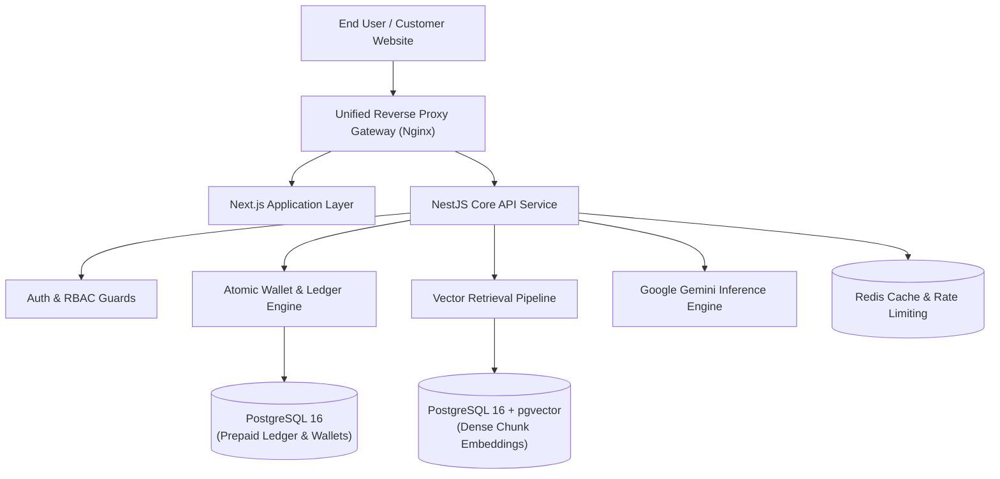
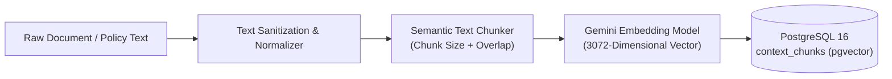
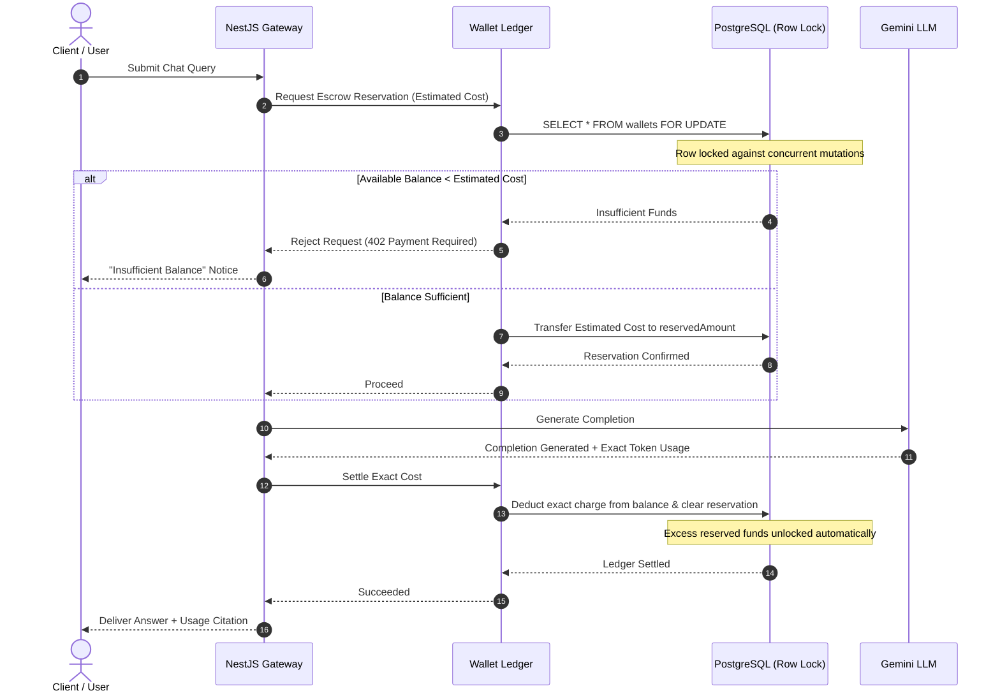
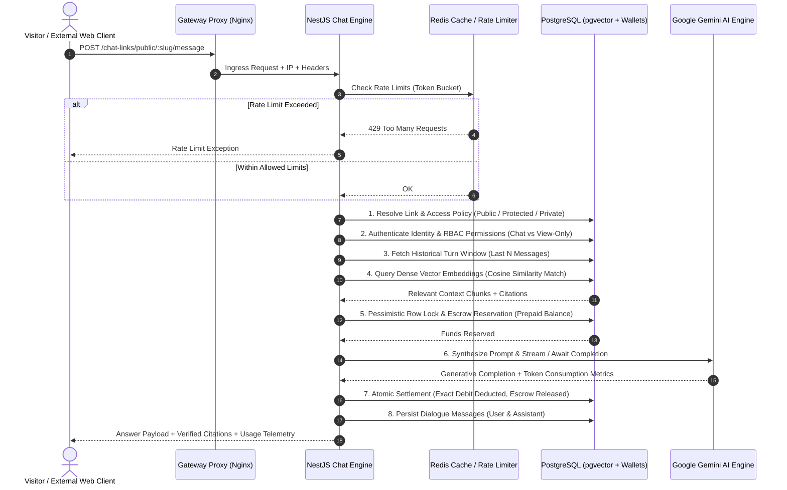
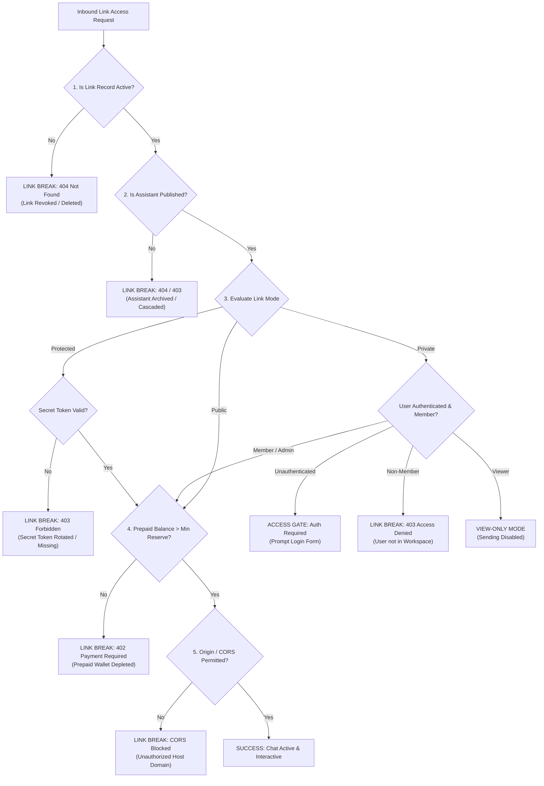

# BotNexa — System Concepts & Architectural Specification

BotNexa is an enterprise-grade, multi-tenant AI assistant and knowledge retrieval platform. It enables organizations to create, ground, meter, and deploy customized AI assistants across web applications, public links, developer APIs, and third-party websites.

This document outlines the core system concepts, architectural models, financial metering protocols, and distribution boundaries that govern the platform.

---

## 1. System Overview & Platform Architecture

BotNexa operates as a distributed multi-tenant platform designed for high concurrency, deterministic financial accounting, and low-latency grounded retrieval.

### Core Architectural Layers

1. **Presentation & Interaction Layer (Client)**:
   - Next.js application leveraging Server-Side Rendering (SSR) and Client Components where real-time interactivity is required.
   - Provides workspace administration, knowledge base management, interactive playgrounds, operational telemetry, and embed code configuration.

2. **Application & Orchestration Gateway (Server)**:
   - Modular NestJS backend serving RESTful APIs, developer endpoints, public slug resolvers, and embed proxy routing.
   - Enforces authentication guards, role-based access control, cryptographic signature validation, and RAG prompt synthesis.

3. **Inference & Grounding Engine**:
   - Integrates with Google Gemini models for high-throughput reasoning and semantic embeddings.
   - Employs dense vector cosine similarity matching via PostgreSQL `pgvector` to inject verified enterprise knowledge into model context windows.

4. **Atomic Prepaid Ledger Engine**:
   - Manages multi-tenant balance reserves, token metering, and transaction ledgers.
   - Implements pessimistic row-level locking to guarantee zero overdrafts during concurrent generation requests.



---

## 2. Workspaces & Tenant Isolation

The Workspace is the primary administrative and security root in BotNexa. Every data entity, transaction, and access token belongs strictly to a single workspace.

### Workspace Tenancy Model

- **Complete Data Partitioning**:
  All database records—including assistants, knowledge contexts, vector chunks, chat sessions, API keys, and wallets—maintain a mandatory foreign key constraint to their parent workspace ID.
- **Tenant Isolation Invariant**:
  Cross-tenant access is prohibited at both the service layer and database query level. Service methods enforce authorization checks to prevent unauthorized access across workspace boundaries.

### Membership & Role-Based Access Control (RBAC)

A user can belong to multiple workspaces with distinct permissions:

- **Owner**: Complete authority over workspace destruction, billing top-ups, member management, and master API credentials.
- **Admin**: Authority to manage assistants, ingest knowledge documents, invite team members, and configure deployment links.
- **Editor**: Authority to create and iterate on assistants, upload context files, and conduct playground testing.
- **Viewer**: Read-only observation of operational telemetry and chat session logs.

---

## 3. AI Assistants Architecture

An Assistant is a configured conversational agent tailored to specific business workflows, tone guidelines, and operational boundaries.

### Assistant Anatomy

1. **System Directives (Instructions)**:
   The foundational persona prompt that sets the behavioral rules, tone of voice, domain boundaries, and fallbacks when an answer cannot be grounded from context documents.
2. **Foundation Model Parameters**:
   - **Model Selection**: Standardized on Google Gemini models optimized for dense reasoning and prompt adherence.
   - **Temperature**: Controls generative determinism (e.g., lower temperature for strict compliance, higher temperature for creative drafting).
   - **Max Token Output**: Hard boundary on completion length to protect against unbounded generation costs.
3. **Access Policies**:
   - **Public**: Discoverable and queryable via public shareable chat links and embeddable website widgets.
   - **Private**: Restricted exclusively to internal workspace team members and authenticated API keys.
4. **Knowledge Associations**:
   One or more Context documents bound to the assistant. The assistant draws strictly from these assigned documents during retrieval-augmented generation.

---

## 4. Knowledge & Contexts (Dense RAG Retrieval)

To eliminate hallucinations and restrict model responses to authorized business policies, BotNexa employs Retrieval-Augmented Generation (RAG) powered by PostgreSQL and the `pgvector` extension.

### The Ingestion Pipeline



1. **Semantic Text Chunking**:
   Raw documents are broken down into overlapping passages. The overlap ensures that sentences crossing passage boundaries retain semantic context without losing coherence.
2. **Dense Vector Embeddings**:
   Passages are transformed into 3072-dimensional vector embeddings via Google Gemini embeddings. These high-dimensional vectors capture contextual meaning beyond exact keyword matches.
3. **Storage in PostgreSQL**:
   Chunk vectors are stored directly inside the relational database alongside their source metadata, eliminating the need for external vector database silos.

### Query-Time Cosine Retrieval

When a user submits a question:

1. The user's query is vectorized in real time using the identical embedding model.
2. An exact vector cosine similarity query is executed against the chunks linked to the target assistant:
   $$\text{Cosine Distance} = 1 - \frac{\mathbf{u} \cdot \mathbf{v}}{\|\mathbf{u}\| \|\mathbf{v}\|}$$
3. The most relevant chunks meeting the similarity threshold are extracted.
4. The retrieved excerpts are assembled into the model's prompt as grounded reference sources.
5. In the response, citations are generated with snippet references and similarity scores so users can verify factual claims against the original documentation.

---

## 5. Wallet & Prepaid Billing Strategy

BotNexa operates on a prepaid usage model designed for transparency and zero-overdraft financial safety.

### Principles of the Financial Ledger

1. **Integer Minor Currency Units**:
   All monetary amounts are tracked in integer minor units (paise for INR, cents for USD). Storing floating-point currency numbers in databases introduces rounding inaccuracies. By using integers throughout, financial precision is maintained.
2. **Auditability & Immutable History**:
   Every balance alteration—whether manual top-ups, reservations, or generation debits—is recorded in an append-only transaction ledger with explicit opening and closing balances.

### Two-Phase Atomic Escrow Protocol

To prevent accounts from going into negative balances when multiple chat queries arrive concurrently, BotNexa implements a two-phase reservation protocol:



1. **Phase 1: Escrow Reservation**:
   - The system calculates the worst-case potential token consumption for the query.
   - A database transaction executes a pessimistic row lock (`SELECT ... FOR UPDATE`) on the workspace wallet row.
   - If available funds are lower than the estimate, the query is rejected immediately with a payment requirement notice.
   - If funds are sufficient, the estimated amount is moved into an escrow bucket (`reservedAmount`), and the row lock is released. Other queries can now evaluate their balances against the remaining available funds.
2. **Phase 2: Atomic Settlement**:
   - The model generates the reply, returning the exact input and output token counts.
   - A subsequent atomic transaction reconciles the ledger: the exact customer charge is deducted from the wallet balance, and the initial reservation is released.
   - If generation fails due to a network interruption, the reservation is canceled and the locked funds are returned to available balance.

---

## 6. Chat Engine & Conversational Pipeline

The Chat Engine orchestrates real-time conversational context, historical dialogue tracking, dense retrieval augmentation, financial escrow, and generative inference.



### Conversational Lifecycle Steps

1. **Input Normalization & Ingress Filtering**:
   User input is trimmed, sanitized, and inspected against payload length limits to guard against buffer overruns and prompt injection attacks.
2. **Conversation State Tracking**:
   External visitors interact using an ephemeral or persistent `conversationId`. The engine maps this identifier to historical turns stored in PostgreSQL, fetching the most recent dialogue exchanges to supply conversational memory without exceeding the model's token capacity.
3. **Semantic Vector Retrieval (pgvector)**:
   The user's query is transformed into a dense vector embedding. A cosine similarity search identifies the top matching context passages associated with the assistant's knowledge base.
4. **Prompt Payload Synthesis**:
   System directives, retrieved context excerpts, few-shot demonstration pairs, and historical turns are compiled into a unified, grounded prompt.
5. **Pre-Flight Financial Escrow**:
   Before dispatching the prompt to Google Gemini, an atomic row lock guarantees that the workspace wallet holds sufficient balance for the maximum potential token generation.
6. **Inference Execution**:
   The model processes the grounded prompt and returns the output along with precise prompt and completion token counts.
7. **Post-Flight Atomic Settlement**:
   The ledger records the actual consumption, debits the tenant balance, releases excess reserved funds, and appends an immutable transaction record.
8. **Verified Citations**:
   The response returns verified citation snippets, indicating the source document, passage excerpt, and semantic similarity score.

---

## 7. Distribution Channels: Public, Protected, and Private Links vs. Embeddable Widgets

BotNexa provides two primary external distribution channels for publishing AI assistants without exposing internal workspace administrative controls:

### Channel Comparison Matrix

| Distribution Model | Public Chat Link | Protected Chat Link | Private Chat Link (Identity-Gated) | Embeddable Web Widget / Iframe |
| :--- | :--- | :--- | :--- | :--- |
| **Delivery URL** | `/chat/[slug]` | `/chat/[slug]?token=[secret]` | `/chat/[slug]` | Embedded script / sandboxed iframe |
| **Access Gate** | Open Internet | Pre-shared security token | Account Authentication (Email + Password) | Signed ephemeral JWT token |
| **Identity Verification** | Anonymous | Anonymous holder of URL token | Authenticated BotNexa user session | Host origin domain whitelist |
| **Permission Granularity** | Full chat for all visitors | Full chat for token holders | Granular RBAC (`chat`, `view`, `none`) | Scoped assistant query capabilities |
| **Primary Use Case** | Public customer support & marketing | Private client previews & vendor testing | Internal enterprise & team-restricted bots | Direct website & web app embedding |

---

## 8. Anatomy of a Chat Link & Lifecycle Resilience

Understanding how chat links are constructed and how they fail is critical for operating reliable external AI deployments.

### Visual Breakdown of a Chat Link

```text
https://botnexa.onrender.com/chat/acme-support-x92k?token=3f8a91b2c4e5e7f8...
└───────────┬──────────────┘ └─┬─┘ └───────┬──────┘ └───────────┬───────────┘
            │                  │           │                    │
     1. Host Gateway     2. Route   3. Identifier          4. Security Gate
                            Path       (Slug / ID)           (Protected Token)
```

#### Detailed Breakdown of the Four Components

1. **Host Gateway (`https://botnexa.onrender.com`)**:
   - **Ingress & TLS Termination**: Handles HTTPS transport encryption, DNS resolution, and routing through the reverse proxy.
   - **Origin & Header Inspection**: Inspects inbound client headers, remote IP addresses, and cross-origin parameters.
2. **Route Path (`/chat/`)**:
   - Identifies the delivery channel. `/chat/` serves the standalone responsive conversational web application. `/embed/` serves the sandboxed, cross-domain iframe for host website widgets.
3. **Identifier / Slug (`acme-support-x92k`)**:
   - **Dual-Lookup Engine**: Can be resolved either via a human-friendly alphanumeric slug or via the direct assistant UUID.
   - **Global Uniqueness Invariant**: In multi-tenant environments, thousands of organizations may create an assistant named "Support". To prevent slug collisions, BotNexa combines a normalized base slug with a high-entropy collision-resistant suffix (`-x92k`).
   - **Auto-Provisioning**: If an assistant is set to public but does not yet possess an active link record, the gateway provisions a permanent link record automatically.
4. **Security Gate (`?token=3f8a91b2...` or Identity Session)**:
   - **Public Mode**: No security gate parameter required. Requests pass directly to the chat engine.
   - **Protected Mode**: The gateway matches the URL's query token against the link's stored high-entropy secret token. If omitted or incorrect, an interactive token prompt blocks access.
   - **Private Mode**: The gate is identity-driven. The gateway ignores query tokens and demands an authenticated user session (email and password), validating workspace membership and role permissions before unlocking the interface.

---

### Why & How Chat Links Break (Link Invalidation & Failure Modes)

A chat link may "break" (cease functioning or reject visitor interactions) due to deliberate administrative interventions or system lifecycle states:



#### Detailed Breakdown of the Six Link Failure Modes

1. **Administrative Revocation Break (`isActive: false`)**:
   When a workspace administrator revokes or disables a chat link from the dashboard, the link's `isActive` flag is toggled to false. Inbound requests immediately break with `404 Not Found` or `Chat link has been disabled`, terminating external access without deleting historical conversation records.
2. **Cascading Archival & Deletion Break**:
   If an administrator deletes or archives an assistant, foreign key cascade constraints permanently deactivate or detach all bound chat links. Re-creating an assistant with the same name generates a new identifier, meaning old distributed URLs remain permanently dead.
3. **Secret Token Rotation Break (Protected Links)**:
   For protected links, regenerating the secret token immediately invalidates every previously distributed URL. Anyone attempting to visit the old URL will be blocked by the Protected Assistant Security Gate.
4. **Prepaid Wallet Depletion Break (HTTP 402 Escrow Lockout)**:
   External chat links draw token costs directly from the owning workspace's prepaid wallet. If the wallet balance falls below the worst-case single-turn reservation cost, the two-phase escrow protocol rejects incoming queries with `402 Payment Required`. While the page opens, external visitors cannot send messages until the workspace wallet is topped up.
5. **Origin & CORS Whitelist Break**:
   When a link is configured with a restricted list of allowed origin domains (`allowedOrigins: ['https://company.com']`), external browsers sending requests from unlisted domains or direct cross-site hotlinks are blocked by HTTP CORS header validation.
6. **Slug Mutation & Renaming Break**:
   If an administrator manually changes an assistant's slug without configuring an alias redirect, visitors accessing bookmarked URLs encounter broken links. To mitigate this, BotNexa's dual-lookup architecture falls back to resolving the assistant's static UUID whenever a slug is not found.

---

## 9. External Chat Architecture & Perimeter Isolation

When users access an assistant through an external chat link, widget, or API, the platform enforces strict perimeter boundaries to isolate internal workspace secrets from external traffic.

### Internal Dashboard Playground vs. External Customer Environments

| Feature / Capability | Internal Workspace Playground | External Standalone Link (`/chat/`) | External Embedded Widget (`/embed/`) |
| :--- | :--- | :--- | :--- |
| **Authentication Scope** | Full workspace user session | Anonymous or Guest Identity | Host-domain signed token |
| **Prompt Inspection** | View & edit raw system instructions | Completely hidden from client | Completely hidden from client |
| **Context Inspection** | Full chunk, score, & vector review | Redacted citations & snippets only | Redacted citations & snippets only |
| **Model Parameters** | Real-time temperature & model tuning | Locked to administrative config | Locked to administrative config |
| **Billing Visibility** | Account balance, debits, & ledger | Hidden (zero billing leakage) | Hidden (zero billing leakage) |

### The Five Perimeter Security Invariants

1. **Zero Secret Leakage**:
   External clients never receive internal system prompts, database connection strings, model hyper-parameters, vector representations, or workspace wallet balances. Citations return only the necessary text snippets to establish grounding credibility.
2. **Redis-Backed Rate Limiting**:
   Every external endpoint is guarded by a sliding-window token bucket algorithm hosted in Redis. Limits are applied per IP address, per link slug, and per session ID to prevent denial-of-wallet attacks, brute-force scraping, and prompt enumeration.
3. **Iframe Sandboxing & DOM Isolation**:
   Embedded chat widgets execute inside an isolated iframe container on the third-party website. The host website cannot read the chat thread's internal state or inspect visitor inputs, and the widget cannot read the host site's session cookies, localStorage, or DOM tree.
4. **Scoped Ephemeral Conversations**:
   External sessions generate unique, unguessable conversation tokens. A visitor can only retrieve and view their own conversational turns within that specific session, preventing unauthorized cross-conversation history leakage.
5. **Role-Based Access Control on Private Links**:
   When an external link is set to `PRIVATE`, identity authentication is strictly enforced. If an authenticated user holds a `VIEWER` role, the backend rejects message dispatches, and the frontend automatically locks the composer into read-only mode while displaying historical answers and citations.

---

## 10. Developer & Enterprise API Platform

BotNexa provides programmatic access for backend systems and automation pipelines.

### Master API Keys vs. Ephemeral Client Tokens

1. **Master API Keys (`bnx_live_sk_...`)**:
   - Generated with a unique identifier and cryptographic hash stored using SHA-256.
   - Carries full billing authority for programmatic chat completions via `/developer/v1/chat/completions`.
   - Used exclusively in secure server-to-server backend environments.
2. **Ephemeral Client Tokens**:
   - Time-limited, signed access tokens issued on demand by your backend using the master API key.
   - Safe for use in mobile applications and single-page apps without exposing master credentials.
3. **HMAC-SHA256 Request Signing**:
   - For high-security environments, BotNexa supports zero-secret request signing where requests are signed using an HMAC timestamp and signature header, eliminating secret transmission over the wire and guarding against replay attacks.

---

## 11. Architectural Summary Matrix

```text
┌────────────────────────────────────────────────────────────────────────┐
│                          BOTNEXA ECOSYSTEM                             │
├─────────────────┬───────────────────┬──────────────────────────────────┤
│ Concept         │ Core Entity       │ Primary Invariant                │
├─────────────────┼───────────────────┼──────────────────────────────────┤
│ Multi-Tenancy   │ Workspace         │ Strict cross-tenant isolation    │
│ Agent Runtime   │ Assistant         │ Directives + assigned contexts   │
│ RAG Pipeline    │ Context Chunks    │ 3072-dim pgvector cosine match   │
│ Ledger Protocol │ Prepaid Wallet    │ 2-phase row-lock zero-overdraft  │
│ Chat Pipeline   │ Conversational Turn│ Escrow reserve -> Inference -> Settle │
│ Link Anatomy    │ Slug & Gate Token │ Host -> Path -> ID -> Security Gate│
│ Link Resilience │ Lifecycle State   │ Revocation, cascade, & wallet checks│
│ External Bounds │ Perimeter Sandbox │ Zero secret leakage & rate limits │
│ Distribution    │ Public/Prot/Priv  │ Identity RBAC + Tokens + Origin  │
│ Developer API   │ REST Gateway      │ Master keys & HMAC signatures    │
└─────────────────┴───────────────────┴──────────────────────────────────┘
```
